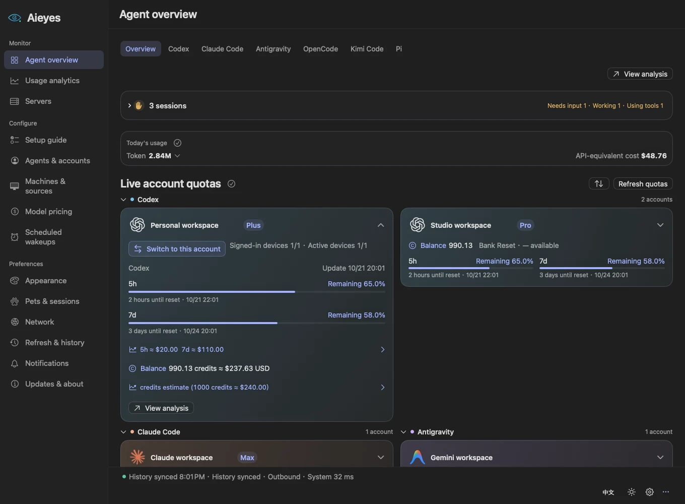
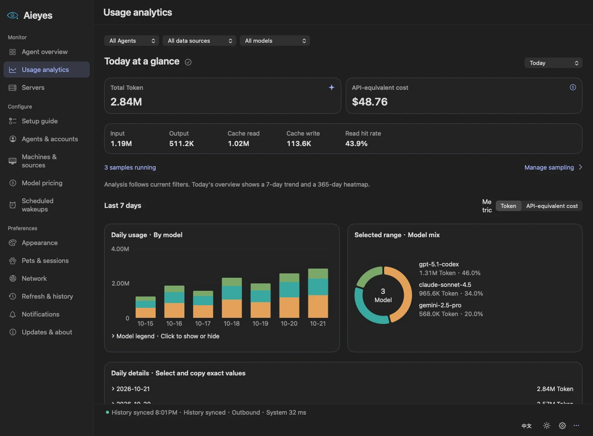
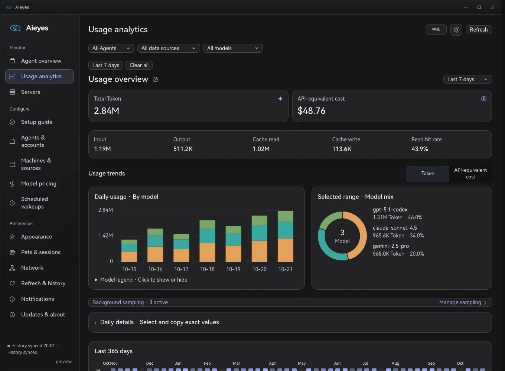

<h1 align="center">Aieyes</h1>

<strong>Your AI agents. One clear view.</strong>

A desktop command center for your AI coding workflow. Usage, quotas, accounts, sessions and remote machines — together.

<a href="https://aieyes.2h3ngy4n.space">Website</a> · <a href="https://github.com/JesmonX/Aieyes/releases/latest">Download</a> · <a href="README.zh-CN.md">简体中文</a>

macOS · Windows · Linux

Your agents live in different tools. Their quotas, usage and remote sessions do too. Aieyes gives you a clear place to check them, with a compact desktop panel for the moments when a full window is more than you need.

## Keep the whole workflow in sight

- **Know what’s left.** See supported account quotas, reset windows, credits and balances alongside today’s token usage.
- **Understand your usage.** Explore daily trends, model breakdowns, cache efficiency and an activity heatmap. Filter by agent, account or machine.
- **Bring accounts together.** Organize agents and their devices, configure supported APIs, and switch saved Codex accounts or API connections while keeping shared conversation history.
- **Notice when you’re needed.** Follow local and SSH session states: working, using tools, waiting for input and complete. Use a desktop pet, menu bar or system tray.
- **Keep remote machines close.** Monitor Linux hosts over SSH: CPU, memory, GPUs, filesystems, disk I/O and network, with the metrics you choose.
- **Set a steady rhythm.** Schedule model wakeups locally or on SSH Linux hosts, with multiple daily times, deployment status and run results.

## Made for your desktop

| Native macOS | Windows |
| --- | --- |
|  |  |

macOS uses a native SwiftUI/AppKit interface. Windows and Linux share the Tauri desktop interface and Rust core. Prefer something smaller? Keep the compact panel nearby, or let a desktop pet show your agents’ state. Import a pet from a file, supported resource link or npm package and switch it from your library.

[Explore all six features with macOS and Windows previews →](https://aieyes.2h3ngy4n.space/#overview)

Screenshots use synthetic data and the product’s English interface. Switch between English and Simplified Chinese in Appearance settings or with the panel language button. Windows images render the actual frontend; they do not represent real Windows desktop materials. Featured pet: [Yuexinmiao by kiffin](https://codex-pet.org/zh/pets/yuexinmiao1/).

## Bring the tools you already use

Codex · Claude Code · Antigravity · DeepSeek · ZCode · Qoder · Grok · Cursor · OpenCode · Kimi · Harness · CodeBuddy · Pi · Oh My Pi

History, quota queries, API setup and session status vary by integration. For example, Cursor’s private request-level token database is not a supported history source. See [integration details](docs/agent-subscriptions.md) and [native-agent verification](docs/native-agent-verification.md) for the current capabilities.

## Get started

1. **[Download the latest release](https://github.com/JesmonX/Aieyes/releases/latest)** for your system.
2. **Follow the setup guide** to enable your agents and select accounts and data sources.
3. **Make it yours:** connect an SSH host, choose your panel and pick a desktop pet.

| Platform | Packages |
| --- | --- |
| macOS 14+ | Apple Silicon and Intel DMG |
| Windows x64 | NSIS installer |
| Linux x64 | AppImage, DEB and RPM |

Release downloads include `SHA256SUMS`. Current macOS builds use ad-hoc signing and Windows builds do not have a publisher certificate; your operating system may ask you to allow the first launch. See [installation and release details](docs/releases.md).

## A few things to know

Usage history stays in a local SQLite database. Provider queries and SSH connections use the sources you configure. API-equivalent cost estimates help explain usage value; subscription charges and provider invoices are separate. Server monitoring shows current samples, while token history is retained. Scheduled model calls may consume quota and require the target device to be available.

## Explore further

- [Website](https://aieyes.2h3ngy4n.space) · [Releases](https://github.com/JesmonX/Aieyes/releases) · [Report an issue](https://github.com/JesmonX/Aieyes/issues)
- [Agents and accounts](docs/agents-and-accounts-settings.md) · [Desktop pets](docs/pets.md) · [Codex API connections](docs/codex-api.md)
- [Development and verification](docs/development.md) · [Architecture](docs/architecture.md) · [Website maintenance](docs/website.md)

Contributions, bug reports and integration samples are welcome. Please remove credentials and private account or server information before sharing diagnostics.
