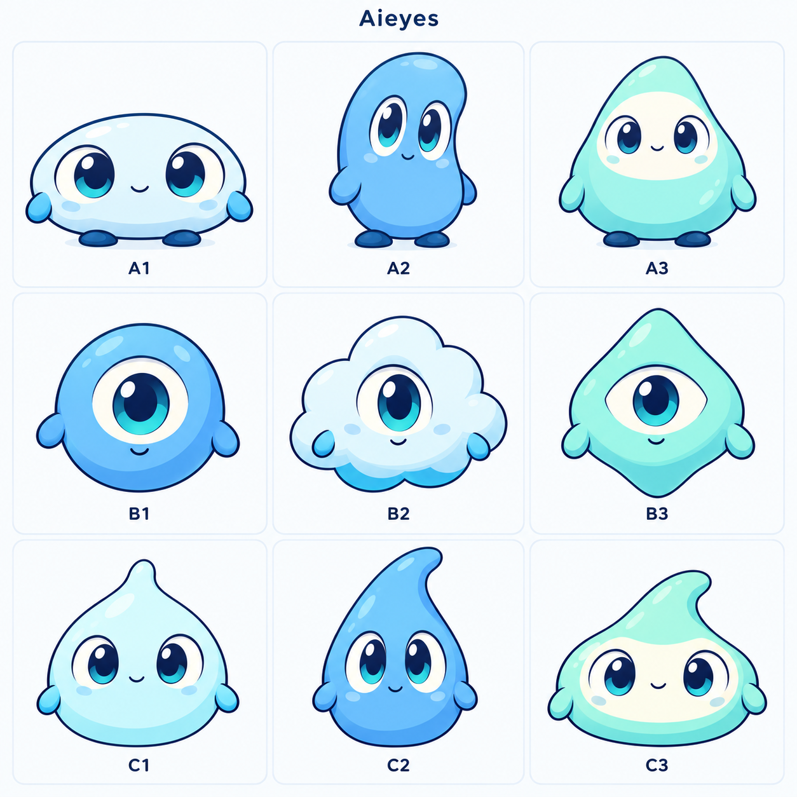

# Aieyes 专属桌宠：第一轮形象探索

状态：候选预览，等待选定角色。2026-10-22。

## 设计方向

九个不同角色采用统一的圆润插画风、大眼睛、蓝青主色、深蓝轮廓和少量薄荷绿。每个角色展示日常睁眼姿态，方便比较轮廓与面部比例。此次从文字描述生成，没有将月薪喵或其他第三方角色图片作为参考输入。

| 编号 | 造型与特点 |
| --- | --- |
| A1 | 扁圆小团子；宽大的双眼与短手脚，安静、亲切，适合陪伴感。 |
| A2 | 蓝色豆形；身体略不对称、眼睛竖长，显得好奇、有精神。 |
| A3 | 薄荷色梨形；浅色脸部与较宽下身，温和、稳重。 |
| B1 | 单眼圆球；结构最简洁，眼神可以成为主要表达方式。 |
| B2 | 单眼软云；蓬松轮廓和柔和配色，轻盈、友善。 |
| B3 | 单眼圆角菱形；眼睛与外轮廓形成识别重点，最直接呼应 Aieyes 品牌。 |
| C1 | 短圆水滴；紧凑、柔软，适合小幅漂浮和弹性动作。 |
| C2 | 弯尖长水滴；侧弯顶部形成明显轮廓，活泼且有方向感。 |
| C3 | 宽底水滴；低重心、偏侧顶部与浅色面部，轻松、可爱。 |

建议优先比较 B3（品牌辨识度）、A1（陪伴感）、C2（动作表现潜力）。这只是设计建议，尚未选择默认角色或正式命名。

## 文件与制作记录

- `aieyes-concepts-v1.png`：1254 × 1254 PNG，含不透明背景、编号和九宫格展示版式；不是可导入的动画图集。
- [prompt-v1.txt](prompt-v1.txt)：实际使用的完整生成提示词。
- 使用内置 imagegen 工具，一次生成整张概念预览板；未使用 API / CLI fallback。
- 已逐格检查九个角色、A1–C3 编号、全身展示，以及 A 行双眼带脚、B 行单眼无脚、C 行双眼无脚的区别。
- 使用浏览器将整张图按 528 × 528 CSS 像素显示，检查角色约百余像素宽时的辨识度：各角色轮廓、眼睛和编号清晰。未进行动画或真实桌面播放验收。

本轮只新增设计预览和说明，未替换应用默认桌宠、官网素材或用户当前选择。选定候选后，再深化多视角、表情和动作；完整透明图集与应用接入属于后续工作。
